# Plugin Lifecycle

`TopoPlugin` 的钩子由 `TopoPluginEngine` 按领域模块声明的依赖驱动。继承任何组件前，先确认**你的类在哪个钩子里注册**——这决定它能访问什么、以及它写入的注册表何时冻结。

首次接入先读[快速开始](../getting-started.md)与[内容注册实作](content-plugin.md)。
跨 TopoPlugin 的依赖由所属模组依赖隐式确认，但被引用内容未必初始化完成；
使用时点与常见兼容方式见[跨插件兼容](../compatibility/topo-plugins.md)。本页保留完整调度与冻结参考。

## 注册窗口与关键节点

图按当前 `RegistrationPlan` 的实际串行顺序绘制。横轴为逻辑刻度，不代表实际耗时。
同一张图同时列出 **NeoForge 事件区间、各表的未冻结窗口、每个 hook、注册管线调用的策略回调与冻结节点**。

- 普通横条：未冻结／尚未关闭写入的窗口；从首个内容事件开始截取，底层表可能更早初始化。
- 高亮横条：对应 hook 的执行区间，覆盖全部插件。推荐在该 hook 贡献内容；未冻结不代表依赖已经就绪。
- 灰色横条：策略／工厂回调。重叠表示发生在同一区间，逐对象的调用顺序见图后说明；不表示并行。
- 红色菱形：冻结或关闭写入；普通菱形：事件边界、`build()` 等关键节点。
- 材料 `build()` 位置仅作示意；单个目标的注入窗口从其构建完成开始，到全部插件结束 `registerMaterials` 为止。

```mermaid
gantt
    title NeoForge 事件、模块注册窗口、hook 与策略回调（逻辑刻度）
    dateFormat x
    axisFormat %S
    todayMarker off

    section NeoForge 事件与引擎阶段
    Mod 构造期／插件登记                 :plugins, 0, 1s
    首个 RegisterEvent HIGHEST           :eventContent, 1000, 22s
    CONTENT                             :phaseContent, 1000, 20s
    DERIVED                             :phaseDerived, 21000, 1s
    LANGUAGE                            :phaseLanguage, 22000, 1s
    各注册表 RegisterEvent LOW 绑定条目   :eventBinding, 23000, 1s
    FMLCommonSetupEvent enqueueWork      :eventCommon, 24000, 1s
    sided setup deferred work           :eventSided, 25000, 1s
    RegisterCapabilitiesEvent           :milestone, eventCapabilities, 26000, 0s
    IMC 阶段（无 Topo hook）             :eventImc, 26000, 1s
    FMLLoadCompleteEvent enqueueWork     :eventComplete, 27000, 1s

    section 插件集合
    插件登记开放                        :pluginWindow, 0, 1s
    插件集合锁定                        :milestone, crit, pluginFrozen, 1000, 0s

    section 配方基础与类型
    RecipeCapabilities 未冻结           :capWindow, 1000, 1s
    registerRecipeFoundation            :active, recipeFoundation, 1000, 1s
    RecipeCapabilities 冻结             :milestone, crit, capFrozen, after recipeFoundation, 0s
    TopoRecipeTypes 未冻结               :typeWindow, 1000, 2s
    registerRecipeTypes                 :active, recipeTypes, 2000, 1s
    TopoRecipeTypes 冻结                 :milestone, crit, typesFrozen, after recipeTypes, 0s

    section 材料基础表
    data／form／post-processor 未冻结    :foundationWindow, 1000, 3s
    registerMaterialFoundation          :active, foundation, 3000, 1s
    材料基础四表冻结                    :milestone, crit, foundationFrozen, after foundation, 0s

    section 材料构建与数据注入
    材料声明与数据写入开放              :materialWindow, 1000, 7s
    registerMaterials（全部插件）       :active, materials, 4000, 4s
    目标材料 build 完成（示意）         :milestone, built, 5000, 0s
    向该已构建材料注入 data             :injection, after built, 3s
    关闭材料声明及数据写入              :milestone, crit, dataClosed, after materials, 0s
    MaterialForm.appliesTo → Predicate.test :done, selection, after dataClosed, 1s
    MaterialDataStrategy.validate        :done, dataValidation, 9000, 1s
    MaterialPostProcessor.validate（激活数据） :done, activationValidation, 9000, 1s
    MaterialFormStrategy.validateMaterial :done, validation, 9000, 1s
    MaterialRegistry 冻结               :milestone, crit, materialFrozen, after validation, 0s
    registerMaterialCreativeTabs        :active, tabs, after materialFrozen, 1s
    MaterialFormStrategy.register        :done, formContent, 11000, 11400
    MaterialPostProcessor.validate（激活组合） :done, processorValidation, 11400, 11700
    MaterialPostProcessor.process        :done, content, 11700, 12000
    registerMaterialFollowUps           :active, followups, after content, 1s

    section 装备
    EquipmentRegistry 未冻结            :equipmentWindow, 1000, 13500
    registerEquipmentKinds              :active, equipment, 13000, 13500
    EquipmentRegistry 冻结              :milestone, crit, equipmentFrozen, after equipment, 0s
    EquipmentStrategy.appliesTo          :done, equipmentSelection, 13500, 14000
    EquipmentStrategy.register           :done, equipmentContent, 13500, 14000

    section 机器与管道
    机器基础六表未冻结                  :machineFoundationWindow, 1000, 14s
    registerMachineFoundation           :active, machineFoundation, 14000, 1s
    机器基础表冻结                      :milestone, crit, machineFoundationFrozen, after machineFoundation, 0s
    Machines 未冻结                     :machineWindow, 1000, 15300
    registerMachines                    :active, machines, 15000, 15300
    Machines 冻结                       :milestone, crit, machinesFrozen, after machines, 0s
    MachineBlockRenderStrategy.validate :done, renderValidation, 15300, 15700
    MachineBlockRenderStrategy.applyBlockModel :done, renderModel, 15300, 15700
    机器方块及共享 BE 类型排队          :machineContent, 15300, 15700
    RecipePreviewPlans.canonical         :done, previewPlan, 15700, 16000
    SlottedRecipeCapability.countPreviewSlots :done, previewSlots, 15700, 16000
    Pipes／分配策略未冻结               :pipeWindow, 1000, 16300
    registerMachineFollowUps            :active, pipes, 16000, 16300
    管道两表冻结                        :milestone, crit, pipesFrozen, after pipes, 0s
    PipeBlockTemplate.configureBlock     :done, pipeBlock, 16300, 16700
    PipeBlockTemplate.configureItem      :done, pipeItem, 16300, 16700
    PipeBlockTemplate.sharedGroup        :done, pipeGroup, 16700, 17000
    PipeBlockTemplate.contributeShared   :done, pipeShared, 16700, 17000

    section 矿脉
    矿脉基础四表未冻结                  :oreFoundationWindow, 1000, 17s
    registerOreFoundation               :active, oreFoundation, 17000, 1s
    矿脉基础表冻结                      :milestone, crit, oreFoundationFrozen, after oreFoundation, 0s
    OreVeinDisplays 未冻结              :oreDisplayWindow, 1000, 18s
    registerOreDisplays                 :active, oreDisplays, 18000, 1s
    显示表冻结并校验模式覆盖            :milestone, crit, oreDisplaysFrozen, after oreDisplays, 0s
    OreVeins 未冻结                     :oreVeinWindow, 1000, 19s
    registerOreVeins                    :active, oreVeins, 19000, 1s
    OreVeinMode.Strategy.validate（build 内） :done, oreValidation, 19000, 1s
    OreVeins 冻结                       :milestone, crit, oreVeinsFrozen, after oreVeins, 0s
    registerOreDatagen                  :active, oreData, 20000, 1s

    section 具体配方与生产线
    ProductionLines 未冻结              :lineWindow, 1000, 21s
    registerRecipes                     :active, recipes, 21000, 1s
    ProductionLines 冻结                :milestone, crit, linesFrozen, after recipes, 0s

    section 语言
    LangRegistry 未冻结                 :langWindow, 1000, 22s
    registerLang                        :active, language, 22000, 1s
    LangRegistry 冻结／随后导出          :milestone, crit, languageFrozen, after language, 0s

    section 游戏注册项绑定中的延迟回调
    机器 blockFactory.apply             :done, machineFactory, 23000, 1s
    PipeBlockTemplate.styleBlockProperties :done, pipeProperties, 23000, 1s
    RegistryLib 条目工厂及 properties 回调 :done, entryFactories, 23000, 1s

    section 运行时挂接
    tooltip／behavior 表未冻结          :runtimeTableWindow, 1000, 27s
    游戏注册项绑定完成                  :milestone, bound, 24000, 0s
    运行时对象挂接窗口                  :runtimeWindow, after bound, 4s
    EquipmentStrategy.machineBehavior    :done, equipmentBehavior, 24000, 24400
    registerRuntime（common deferred）  :active, runtimeHook, 24400, 25000
    机器资源类型安装能力 provider       :milestone, capabilityProviders, 26000, 0s
    内部 READY 冻结 tooltip／behavior   :milestone, crit, runtimeFrozen, 28000, 0s
```



配方基础 → 配方类型 → 材料基础 → 材料 → 装备 → 机器是依赖链。
矿脉实际只依赖材料内容生成；图中机器先于矿脉，是当前步骤 ID 排序的结果，不是两者之间的依赖约束。
具体配方须等待全部 CONTENT 步骤完成，语言导出随后执行；这三个阶段都在**首个 `RegisterEvent` 的 HIGHEST 回调内**完成。
后续 `RegisterEvent` 不会重复执行 Topo hook；图中的 LOW 区间汇总各游戏注册表的后续绑定事件。

`build()` 不是冻结节点；`Material.data(use)` 的截止点是图中的“关闭材料写入”，早于形态匹配和
`MaterialRegistry` 冻结。形态匹配、校验和内容生成期间均不能继续注入。
内容排队结束也不等于游戏对象已经绑定；Entry / Supplier 的 `.get()` 需等待对应游戏注册项绑定完成。
`registerRuntime` 只在 common setup 的 deferred work 中调用一次；sided setup 不会再次调用它，
但共享运行时表仍保持开放，到 load complete 的 deferred work 才冻结。

图的来源为 `TopoPluginEngine` 的事件监听器、各 `*RegistrationModule.define` 的依赖及 finish 动作、
`MaterialRegistry.freeze` 的写入封口、领域生成器与 RegistryLib Builder 的回调调用点，以及当前 NeoForge 版本的事件顺序。
修改调度时应同步更新图中的节点与窗口。

### 策略回调的调用粒度

图中小数刻度只用于展开同一步骤内部的动作，没有耗时含义。以下顺序来自实际调用点，
不能把同一区间内的两条横条理解为“先遍历全部对象执行第一条，再遍历全部对象执行第二条”。

| 区间 | 回调与实际顺序 |
|------|----------------|
| 材料匹配 8–9 | 对全部材料／形态组合调用 `MaterialForm.appliesTo`，转到声明的 `Predicate.test`；只有返回 true 的形态入选，配置覆盖不会跳过规则。全部结果计算完成后统一发布，求值期间形态集合均为空。 |
| 材料校验 9–10 | **逐材料**先校验全局 data，再逐个匹配形态校验其作用域 data（`MaterialDataStrategy.validate`）并调用 `MaterialFormStrategy.validateMaterial`。激活后处理器的 data 校验器还会调用一次 `MaterialPostProcessor.validate`。 |
| 材料生成 11–12 | 先为全部材料／形态调用 `MaterialFormStrategy.register`；随后只对缓存的已激活材料／后处理器组合调用 `validate`，全部通过后再调用 `process`。这次后处理校验独立于冻结前的激活数据校验；未激活组合不收到调用。 |
| 装备生成 13.5–14 | **逐材料／装备种类组合**调用 `EquipmentStrategy.appliesTo`，仅当其返回 true 时立即调用该组合的 `register`。装备表此时已冻结。 |
| 机器生成 15.3–15.7 | 对有渲染声明的每台机器，依次调用 `MachineBlockRenderStrategy.validate`、`applyBlockModel` 配置 Builder；随后排队方块及共享 BE 类型。策略内提交的模型 datagen lambda 仍在 datagen 时执行。 |
| 配方预览计划 15.7–16 | 对每个配方类型调用安装器的 planner（当前为 `RecipePreviewPlans.canonical`）；计算槽位布局时调用 `SlottedRecipeCapability.countPreviewSlots`。此时配方类型、机器表已冻结，具体配方尚未注册。 |
| 管道生成 16.3–17 | 逐管道调用 `PipeBlockTemplate.configureBlock`、`configureItem` 并排队；全部管道排队后，通过 `sharedGroup` 按所属 RegistryCore 和共享组去重，再调用 `contributeShared`。 |
| 矿脉声明 19–20 | `OreVeins.Builder.build` 内调用 `OreVeinMode.Strategy.validate`；这是声明 hook 内的校验，发生在矿脉表冻结之前。 |
| 条目绑定 23–24 | RegistryLib 创建游戏对象时执行工厂及 `properties` 链；机器的 `blockFactory.apply` 和管道的 `PipeBlockTemplate.styleBlockProperties` 位于这里。`configureBlock`／`configureItem` 早在内容排队时已执行。 |
| common deferred 24–25 | 宿主先对已生成的装备条目调用 `EquipmentStrategy.machineBehavior` 并挂接非空行为，再执行全部插件的 `registerRuntime`。返回的行为对象此时仅被安装，其游戏交互方法不会因此执行。 |
| 能力注册事件 26 | `MachineResourceTypes.registerBlockEntityCapabilities` 安装能力 provider；provider 中读取机器侧资源 handler 的 lambda 要到能力查询时才执行。 |

### 不属于启动注册窗口的策略回调

注册策略对象与执行其所有方法是两个时点。以下回调由使用场景触发，没有统一的启动横轴，
也不会重新开放上图中已经冻结的表。

| 模块 | 回调 | 触发点 |
|------|------|--------|
| 机器 | `MachineBlockEntityFactory.create`、`ResourceDataFieldFactory.create` | 世界创建机器 BE、机器实例配置资源数据字段时；注册共享 BE 类型不会提前创建每个机器实例。 |
| 管道 | `PipeDistributionStrategy.initialPortConfig`、`budget`、`distribute`、`contributeConfigUi`、`configCodec` | 分别在端口初始化／切换／恢复、传输预算计算、批次分配、配置界面构建、配置编解码时使用。分配策略表冻结只关闭声明。 |
| 矿脉 | `OreVeinMode.Strategy.collectGrid`、`OreVeinShape.Strategy.contains`、`OreAirExposurePolicy.Strategy.discardExposed`、`OreConflictPolicy.Strategy.canReplace` | 世界矿脉规划与放置时。 |
| 矿脉展示 | `OreVeinDisplay.Strategy.buildPreview`、`OreAirExposurePolicy.Strategy.describe` | 客户端矿脉预览／说明构建时。 |
| 矿脉 feature 桥 | `OreVeinMode.Strategy.collectFeature` | 内容插件的 `VanillaOreFeatureBridge.featureVeins` 在 configured feature、placed feature、biome modifier 的 datagen bootstrap 内调用。`registerOreDatagen` 仅安装这些 bootstrap 回调。 |
| 配方 UI | `SlottedRecipeCapability.createPreviewInputSlotWidget`、`createPreviewOutputSlotWidget`、`createLiveSlotWidget`、`previewInputSlotAssignment` | 构建预览／实况 UI 及分配预览内容时；与启动时的 `countPreviewSlots` 区分。 |
| 配方执行 | `RecipeCapability` 的匹配、传输及 `DirectTickIoBinding` 回调 | 配方搜索、开始执行和工作 tick 时；注册能力本身不执行配方。 |
| 资源生成 | 向 RegistryLib 提交的模型、标签、配方等 provider 回调 | datagen 对应 provider 运行时；声明 provider 的 hook 可以已经结束。 |

## 钩子与冻结责任

| 索引 | 钩子                                     | 冻结于此钩子之后                                                                         | 此时可访问                                                     |
|----|------------------------------------------|------------------------------------------------------------------------------------------|----------------------------------------------------------------|
| 1  | `registerRecipeFoundation(recipe)`       | `RecipeCapabilities`                                                                     | 机器资源类型、配方能力                                         |
| 2  | `registerRecipeTypes(recipe)`            | `TopoRecipeTypes`                                                                        | 已冻结的配方能力                                               |
| 3  | `registerMaterialFoundation(material)`   | 材质四表（data/form/post-processor）                                                     | 尚未有材质实例                                                 |
| 4  | `registerMaterials(material)`            | `MaterialRegistry`                                                                       | 已冻结的表单、数据类型、后处理器                               |
| 5  | `registerMaterialCreativeTabs(material)` | —                                                                                        | 已冻结的材质                                                   |
| 6  | （引擎内部）                             | —                                                                                        | 为每个材质铸造表单物品；先跑全部 `validate` 再跑全部 `process` |
| 7  | `registerMaterialFollowUps(material)`    | —                                                                                        | 全部表单物品已排队；可用稳定 ID，不能读取游戏实例                 |
| 8  | `registerEquipmentKinds(equipment)`      | `EquipmentRegistry`                                                                      | 全部材质（含数据）；之后引擎按 (材料 × 种类) 铸造物品          |
| 9  | `registerMachineFoundation(machine)`     | 机器六表（resource type / UI icon / render / part role / property display / attachment） | 尚未有机器定义                                                 |
| 10 | `registerMachines(machine)`              | `Machines`                                                                               | 已冻结的机器基础表；之后引擎铸造方块/BE 并安装预览计划         |
| 11 | `registerMachineFollowUps(machine)`      | `PipeDistributionStrategies`、`Pipes`                                                    | 全部机器定义（方块/BE 已铸造）                                 |
| 12 | `registerOreFoundation(ore)`             | 矿石四表（shape / mode / air exposure / conflict）                                       | 尚未有矿脉                                                     |
| 13 | `registerOreDisplays(ore)`               | `OreVeinDisplays`                                                                        | 已冻结的模式表；每种模式必须有对应显示                         |
| 14 | `registerOreVeins(ore)`                  | `OreVeins`                                                                               | 已冻结的矿石基础表                                             |
| 15 | `registerOreDatagen(ore)`                | —                                                                                        | 全部矿脉                                                       |
| 16 | `registerRecipes(recipe)`                | `ProductionLines`                                                                        | 全部领域定义及已排队的 RegistryLib Entry；游戏对象仍未绑定      |
| 17 | `registerLang(lang)`                     | `LangRegistry`                                                                           | 全部                                                           |
| 18 | `registerRuntime(runtime)`               | 此时不冻结；load complete 才冻结共享运行时表                                               | 已绑定的游戏对象；common setup deferred work                  |

表中索引用于查找，不是跨领域的依赖声明。矿石基础只依赖材质内容生成，机器与矿石可以独立编排；
全部 CONTENT 步骤完成后才进入具体配方和语言阶段。不要依赖无依赖边步骤之间的偶然次序。

条目显示名由生成它的 RegistryLib Builder 统一持有，通过 `lang(Map)` 提交各语言数据；
LANGUAGE 阶段只导出独立的 Topo `LangKey`。Topo 生成条目名称与 `LangKey` 的冲突在声明时拒绝，
与先后顺序及是否运行 datagen 无关。直接绕过 Topo 使用 RegistryLib 的链仍由 RegistryLib 校验。

## 加载与事件顺序

默认依赖模式下，只有 Topo 宿主接线 `TopoPlugins.attachHost(modEventBus)`：

| 时机 | 执行内容 | 边界 |
|------|----------|------|
| 所有 Mod 构造期 | `TopoPlugins.register(plugin)` | 只登记插件；不要手工提前启动引擎 |
| 首个 `RegisterEvent`，`HIGHEST` | 锁定插件表并执行上表钩子 1–17 | 完成所有游戏内容的 RegistryLib 排队 |
| `RegisterEvent`，RegistryLib `LOW` | 将排队条目注册到游戏注册表 | 此前只能传递 Entry / Supplier，不能提前 `.get()` |
| `FMLCommonSetupEvent.enqueueWork` | 宿主绑定管道面板与装备行为，再调用全部插件的 `registerRuntime(runtime)` | 主线程，游戏条目可用；不同 Mod 任务间无先后承诺 |
| sided setup 的 deferred work | 完成客户端专用绑定 | 同样必须在 load complete 前完成 |
| `RegisterCapabilitiesEvent` | 为共享机器 BE 安装已声明资源类型的能力 | 由宿主接线，资源类型表已经冻结 |
| `FMLLoadCompleteEvent.enqueueWork` | 引擎冻结 `ItemTooltipUis`、`MachineItemBehaviors` | 此后不能再注册 provider / behavior |

NeoForge 的 `RegisterEvent` 按优先级跨 Mod 派发，因此 `HIGHEST` 的内容排队先于
RegistryLib 的 `LOW`。common setup 属于并行生命周期事件，不能靠另一个 Mod 的监听器
优先级保证其 deferred work 先执行；共享运行时表必须在后续生命周期事件中冻结。

上表的能力注册事件位置按项目当前 NeoForge 26.1.2.107 的 `CommonModLoader.load` /
`RegistrationEvents.init` 实现核对：发生在 common / sided setup 之后、IMC 和 load complete 之前。

每个钩子先遍历**全部插件**，再冻结对应表，随后进入下一个钩子。
运行时与 datagen 共用内容管线；datagen 不依赖 common setup 或 load complete 才完成资源声明。
语言键通过声明它的 `LangDomainRegistration` 所属 RegistryCore 导出。
仅运行 `--mod mymod` 会生成 mymod 拥有的键；Topo 自身 API 文案由 Topo 的资源包提供。

## 插件顺序

插件只需调用 `TopoPlugins.register(plugin)`，无需分配插件 ID 或重复声明一份插件依赖。
跨插件依赖由所属模组的依赖关系隐式确认；依赖存在不等于插件或内容已初始化。
引擎在每个阶段遍历全部插件后再冻结该阶段注册表；foundation 钩子因此总是先于对应内容钩子，
不需要在 API Plugin 与内容 Plugin 之间额外配置依赖。引擎按 Mod ID 和插件类名稳定排序，仅用于让独立贡献
和诊断结果可复现；插件不得依赖同一阶段其他插件先执行。模组构造器到达顺序不属于 API 契约。

对于身份和声明内容相同的插件集合，改变 `register` 的调用顺序不会改变引擎的钩子顺序、
派生结果或冻结表的条目顺序。引擎只获取一次锁定快照、编译一次计划；领域模块的组合清单
顺序也不决定计划中的执行顺序。钩子内部仍须使用确定的输入与遍历顺序，不应在构造期抢先写入领域注册表。

```java
TopoPlugins.register(new MyModPlugin());
```

插件继承 `TopoPlugin` 并在构造器中 `super(registry)`。基类缓存领域 API，
`modId()` 从 RegistryCore 推导，各领域 API 使用同一归属；无需手工维护 getter。
材质没有所属 Plugin 时直接报错，不能退回任意其他 Plugin 的 RegistryCore。
在 `registerMachineFollowUps(machine)` 中使用 `machine.pipe("copper_pipe")`，管道及共享资源生成
使用该 Plugin 的 RegistryCore。旧 `Pipes.register("...")` 保留 `topo` 命名空间和宿主归属，
新插件应迁移到领域入口。

## 阶段状态与失败

引擎依次执行 CONTENT → DERIVED → LANGUAGE → RUNTIME → READY。
CONTENT 内按领域依赖排序；DERIVED 执行具体配方，LANGUAGE 统一导出翻译。
已完成的阶段可重复调用，不重复生成内容；越序和重入会报错。
阶段执行异常后保留原始原因并终止后续启动，不能重试已经部分修改的注册表。
插件钩子的异常包含插件类名、Mod ID 和钩子名称；修正后必须重启进程。

插件收集器锁定后复用同一个不可变快照，生命周期状态、快照工厂和执行计划归属于同一个引擎实例；
生产环境仍只接线一个宿主。

冻结点后写入会抛异常。例如 `MaterialForm` 必须在 `registerMaterialFoundation` 声明，
`registerMaterials` 只能引用已经声明的形态。静态字段不会因锁定插件表而自动初始化，
每个声明类都应在所属钩子内显式触发 `init()`。

材料的 `build()` 只发布句柄，不关闭数据写入。同一 `registerMaterials` 窗口内可用
`targetMaterial.data(use)` 直接给其他插件已构建的材料补充数据；全部插件完成该钩子后，
引擎关闭写入、统一匹配形态并校验，再冻结材料。重复数据类型拒绝覆盖。

## 接入与迁移

依赖方只在构造期 `TopoPlugins.register(new MyPlugin())`。原有命名钩子继续直接覆写，
无需 `configure` 或手工登记回调。领域对象的字段和 getter 改由基类持有。
宿主只调用一次 `TopoPlugins.attachHost(modEventBus)`；分阶段启动方法属于内部实现，不能提前启动内容管线。

`registerRecipes` 位于全部内容领域之后；被材质后处理器引用的配方类型和生产线应在
`registerRecipeTypes` 声明，其余具体配方在 `registerRecipes` 组装。
此时 Entry 已排队，但 RegistryLib 尚未绑定游戏对象，不能提前 `.get()`。

provider 和额外物品行为放在 `registerRuntime(runtime)`，使用 `runtime.tooltip` /
`runtime.itemBehavior`。装备策略的 `machineBehavior()` 由框架在该钩子前自动绑定。
不再单独接线 `PipeSpecTooltips`，也不要在领域代码中冻结共享运行时表。
客户端专用绑定可使用 client setup；所有共享表贡献最迟在 common / sided setup 完成。

## 包分组与扩展边界

| 包 | 职责 |
|---|---|
| `api.api.plugin` | `TopoPlugin`、`TopoPlugins`、领域 API 工厂与贡献标记 |
| `plugin.hook` | 按领域组织的命名钩子，基类提供全部内置接口 |
| `plugin.internal` | 不可变快照、依赖计划、阶段状态及 NeoForge 事件适配 |
| `plugin.internal.module` | 各领域的声明调度、生成、校验与冻结责任 |

`internal` 中为跨子包组合而公开的类型仍是框架实现，不是下游接入契约。
内部包及宿主接线、底层 `begin` / `freeze` 方法使用 `@ApiStatus.Internal` 标记；引擎和快照本身为包内可见。
插件基类、命名钩子及领域策略保留原有继承和覆写能力。
新增框架领域时：

1. 定义领域 API 和 `RegistrationDomain` 工厂；定义继承 `TopoContribution` 的命名钩子接口。
2. 在领域模块中用 `RegistrationPoint` 绑定接口方法与 API；通过 `RegistrationModule.define` 声明步骤依赖及贡献后的冻结动作。
3. 将模块加入 `TopoContentBootstrap` 的组合清单；使用该领域的插件实现对应接口。

不需要修改引擎或给 `TopoPlugin` 增加调度逻辑；若希望所有插件自动获得新领域的默认钩子，
可让基类继承该接口。模块只声明真实依赖，不依赖组合清单的先后顺序。
计划在执行前拒绝缺失依赖、环、指向更晚阶段的依赖、重复步骤和未安装的贡献接口；
同一依赖层按步骤 ID 确定顺序。新增 CONTENT 领域也会自动处于具体配方与语言导出之前。
贡献接口可以继承、组合和覆写已安装的钩子；新增钩子仍需安装对应领域模块。

当前仅保证 Topo 单宿主的静态加载；不支持热重载，也不承诺可移除 Topo Mod 的完全嵌入。
