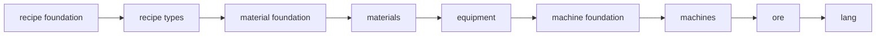

# Getting Started

## 添加依赖

```gradle
// build.gradle
repositories { 
    maven {
        name = "ptcrysReleases"
        url = uri("https://maven.ptcrys.net/releases")
    }
}
dependencies {
    implementation "net.ptcrys:Topology:${topology_version}"
}
```

## 架构：纯库 + 你的内容

Topology 只分发框架 API，**不分发任何玩法内容**。你需要的全部功能通过继承框架基类实现：

```
net.ptcrys.topo.api.* → 库本体（全部继承扩展点都在这里）
你的 Mod               → 继承基类 + TopoPlugin 注册，与库解耦
```

内容注册的唯一通道是 `TopoPlugin`——没有隐藏的特权通道。

## TopoPlugin — 内容注册入口

所有内容（材料、机器、配方、矿石……）通过实现 `TopoPlugin` 接口注册：

```java
public final class MyModPlugin implements TopoPlugin {

    private final MaterialDomainRegistration materials = MaterialDomainRegistration.of(this);
    private final EquipmentDomainRegistration equipments = EquipmentDomainRegistration.of(this);
    private final RecipeDomainRegistration recipes = RecipeDomainRegistration.of(this);
    private final MachineDomainRegistration machines = MachineDomainRegistration.of(this);
    private final OreDomainRegistration ores = OreDomainRegistration.of(this);
    private final LangDomainRegistration langs = LangDomainRegistration.of(this);

    @Override
    public String modId() {
        return "mymod";
    }

    @Override
    public RegistryCore registry() {
        return MyMod.REGISTRY; // 你 Mod 的 RegistryCore
    }

    @Override
    public MaterialDomainRegistration material() { return materials; }
    @Override
    public EquipmentDomainRegistration equipment() { return equipments; }
    @Override
    public RecipeDomainRegistration recipe() { return recipes; }
    @Override
    public MachineDomainRegistration machine() { return machines; }
    @Override
    public OreDomainRegistration ore() { return ores; }
    @Override
    public LangDomainRegistration lang() { return langs; }

    // 六个领域注册 API 通过 XDomainRegistration.of(this) 创建，
    // 框架校验它们与 modId()/registry() 一致。

    @Override
    public void registerMaterials(MaterialDomainRegistration m) {
        // ingotForm 是你在 registerMaterialFoundation 里注册的自定义形态（见 Material 文档）
        m.material("copper").lang("Copper", "铜").form(ingotForm).build();
    }

    @Override
    public void registerRecipeTypes(RecipeDomainRegistration r) {
        r.recipeType("macerating").displayName("Macerating", "粉碎");
    }

    @Override
    public void registerMachines(MachineDomainRegistration m) {
        // 声明机器
    }

    @Override
    public void registerRecipes(RecipeDomainRegistration r) {
        // 添加配方
    }

    @Override
    public void registerOreVeins(OreDomainRegistration o) {
        // 声明矿脉
    }

    @Override
    public void registerLang(LangDomainRegistration lang) {
        // 收集翻译
    }
}
```

## 接线：依赖方只注册插件

```java
@Mod("mymod")
public class MyMod {
    public static final RegistryCore REGISTRY = RegistryCore.create("mymod");

    public MyMod(IEventBus modEventBus) {
        TopoPlugins.register(new MyModPlugin());
    }
}
```

在你的 `neoforge.mods.toml` 声明对 `topo` 的必需依赖，并设置 `ordering="AFTER"`。
Topo 宿主负责接线 `TopoPluginEngine.register(modEventBus)`，依赖方无需重复接线，也无需手工监听
`RegisterEvent` 或调用各个 bootstrap 方法。

物品实例可用后才能执行的绑定，使用 NeoForge 已有的事件任务：

```java
// 在你的 Mod 构造器内接线：
modEventBus.addListener((FMLCommonSetupEvent event) -> event.enqueueWork(() -> {
    // ItemTooltipUis.register(myItem.get(), myPanelProvider);
    // MachineItemBehaviors.register(myTool.get(), myBehavior);
}));
```

共享表由引擎在 `FMLLoadCompleteEvent` 的主线程任务中统一冻结。插件不能自行调用
`ItemTooltipUis.freeze()` 或 `MachineItemBehaviors.freeze()`。
common setup / client setup 的 `enqueueWork` 均在冻结点之前；不同 Mod 的任务间不保证顺序。
Plugin 的内容排序不影响这些事件任务。

同一 Mod 可以提供多个 Plugin，但必须共用其 RegistryCore。注册时无需提供 Plugin ID，
也不声明 Plugin 之间的依赖：各阶段会遍历全部 Plugin，再统一冻结对应注册表。
因此 API Plugin 应在 foundation 钩子声明数据类型、形态等基础内容，具体内容 Plugin
在后续内容钩子使用这些声明。插件在相同钩子中的执行次序不是依赖契约；独立贡献才可安全组合。

```java
TopoPlugins.register(new MyApiPlugin());
TopoPlugins.register(new MyContentPlugin());
```

引擎按 Mod ID 和类名稳定遍历插件，使结果不受模组构造器到达顺序影响；此排序只为可复现性，
不应用于表达同一阶段内的先后依赖。

:::info
Topo 宿主还负责资源能力、管道引擎、网络、渲染、tick 心跳等框架运行时。
Plugin 的各领域 API 应创建一次并保存在字段中，不能在 getter 里每次重新创建。
:::

## 生命周期与冻结点

TopoPluginEngine 按固定顺序调用各阶段。每个阶段结束后，对应注册表 **冻结**（只读）：



| 阶段                | 做什么                                 | 冻结的注册表             |
|---------------------|----------------------------------------|--------------------------|
| recipe foundation   | 注册自定义 RecipeCapability            | capability 表            |
| recipe types        | 注册配方类型                           | recipe type 表           |
| material foundation | 注册自定义 MaterialData / MaterialForm | data / form 表           |
| materials           | 声明材料 + 注册 form 内容 + 后处理器   | material 表              |
| equipment           | 为 (kind, material) 生成物品           | —                        |
| machine foundation  | 冻结 resource type / UI / render       | resource type 表         |
| machines            | 声明机器 + 注册 block / block entity   | machine 表               |
| ore                 | 声明矿脉 + 数据生成                    | shape / mode / policy 表 |
| lang                | 收集所有翻译键，按所属 Plugin 导出     | lang 表                  |
| common setup        | 各 Mod 的运行时绑定               | 暂不冻结                 |
| load complete       | 结束共享运行时表的注册窗口             | tooltip / item behavior  |

:::caution
**冻结点规则** — 冻结点后不能再添加新条目。例如在 `registerMaterials()` 中不能再注册新的 `MaterialForm`——
它必须放在 `registerMaterialFoundation()` 里。完整生命周期表见
[Plugin Lifecycle](foundation/lifecycle.md)。
:::

## 关键约定

- **领域 API 传裸路径**（如 `material("copper")`）；生成的 ID 带 Plugin 命名空间 `mymod:copper`
- **双语名称**：每个有显示名称的条目必须提供 `en` 和 `cn`
- **Topology 只提供基建**：不在创造模式物品栏、JEI 中添加内容
