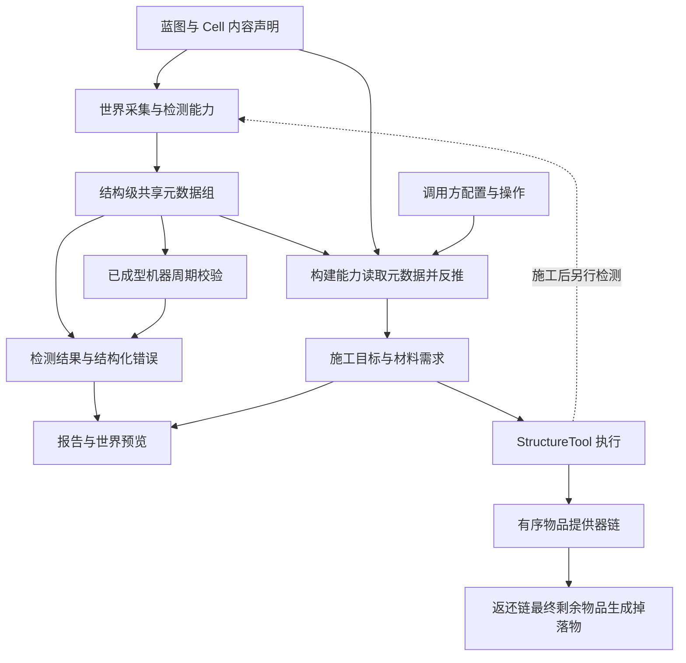

# 多方块检测与结构工具设计

状态：2026-11-07 已开始代码迁移。检测器、内容绑定、统一结果和控制器元数据域已接入；运行回归与游戏验收待开发者执行。本页仍是整体方案入口，实际检测 API 见 [多方块蓝图](multiblock.md)。

本轮实现机器结构检测重构，并将已有诊断、预览和工具调用迁移到统一检测结果与元数据。放置选择扩展、工具与 Item 解耦、批量取料／返还和拆除仍是后续工作，不能据此认定整份方案已经完成。
现有蓝图声明见 [多方块蓝图](multiblock.md)，工具原型说明见 [结构工具](multiblock-tool.md)。

## 目标与边界

核心模型：**多方块结构 = 蓝图 + 元数据**。

蓝图描述结构布局、检测要求和能力绑定；元数据承载某个具体结构在探测、解析和后续使用中确定的信息。
同一蓝图可以配合不同元数据表达不同的具体结构状态，检测、周期校验与构建围绕这两部分协作。

| 元数据来源 | 负责提供的信息 |
|---|---|
| 框架自身 | 框架解析或探测所得的朝向、整体镜像、重复段等基本结构信息 |
| 其他 mod 注入的检测能力 | 从实际结构提取并写入自定义信息，后续能力通过约定的键读取、校验或反推 |

两类来源使用同一组结构元数据和公共访问契约，外部数据的具体语义由定义方维护。

保留现有蓝图的局部坐标、24 向锚定、字符层、重复段和叠加模块能力。
此次重设计的重点是 Cell 的统一检测契约、结构化错误，以及检测、展示和放置之间的数据边界。

用户已确认的要求：

- 镜像是引擎的基本结构检测能力，不是蓝图的许可开关，也不是需要外部注入的检测策略。
- 镜像作用于整个多方块结构，本体和全部模块共用同一个镜像变换，不能分别选择。
- `CellPredicate` 是足够灵活、可复用的检测器，不绑定具体检测内容。
- 外部 mod 可以提供自己的 Cell 检测逻辑，使用与内置实现相同的输入和结果协议。
- 元数据组贯穿整个结构检测周期，本体、模块、各 Cell 和注入能力共享；检测自行探测并累积元数据，构建根据已有元数据反推目标。成型后可保留元数据供周期检测复用。
- 正式元数据复用控制器所属机器现有的 `MachineDataScope`，由控制器组件声明专用 `DataScope` 分组；外部能力访问该分组的适用视图。
- 检测和放置使用分别定义的契约：检测判断现有事实，放置选择具体目标并执行世界修改。
- 一个位置有多种可放置类型时，框架提供可注册、可注入的判断与选择接口，由接入方实现具体能力。同型、等级只是外部需求示例，不作为框架内置策略或数据模型。
- `StructureTool` 是结构工具能力，不绑定 Item；Item、GUI、命令、机器等都可以作为调用方。
- 材料通过可扩展的物品提供器接入，背包只是其中一种实现。
- 提供器按顺序批量处理剩余需求 Map，取走多少就扣减多少，再交给下一个提供器，避免逐物品反复读取。
- 物品提供器还需支持批量接收返还物品；所有提供器处理后仍有剩余，在指定世界位置生成掉落物。
- 支持分批补建与一键拆除。材料不足不要求整台机器一次建完，已有方块不能被覆盖。

## 职责划分

| 对象 | 负责 | 不应承担 |
|---|---|---|
| 蓝图与 Cell 定义 | 布局、具体检测条件、检测器绑定、展示和建造所需的内容声明 | 检测器实例中的内容存储、实际世界修改 |
| 机器与通用数据系统 | 提供现有 `MachineDataScope`、有类型字段、持久化和同步设施 | 定义多方块专属字段、检测或放置业务规则 |
| 多方块控制器组件 | 组合蓝图与元数据，在自身数据域声明结构元数据分组，协调能力与生命周期 | 要求扩展方继承控制器或新增机器子类 |
| `CellPredicate` | 根据本次输入与共享元数据检测，按能力契约探测／校验数据，输出标准结果 | 在检测器实例中绑定具体 Cell、方块、角色、材料候选、图标、文案或放置行为 |
| 流程元数据组 | 统一承载框架与外部检测能力提供的结构信息，支撑后续校验和构建反推 | 保存检测算法或替代具体阶段的结果、权限与资源核算 |
| 检测引擎 | 朝向、镜像、重复段解析、数据采集、维护周期元数据、调用检测器、聚合结果 | 玩家交互、背包读取、聊天输出 |
| 展示层 | 将检测结果转换为本地化报告、图标和虚影 | 再次推断检测失败原因 |
| 外部放置判断与选择实现 | 根据已有元数据、内容声明和配置反推具体目标，补充必要选择 | 取代结构检测、直接扣料或修改世界 |
| `StructureTool` | 检测、施工规划、分批放置、拆除、返还与执行结果 | 固定要求玩家或手持 Item、硬编码某个仓储 mod |
| 物品提供器 | 批量取出与批量接收，报告实际转移数量 | 决定结构布局、绕过施工权限 |
| 调用方 | 交互、配置来源、提供器顺序、执行权限与反馈方式 | 另写一套 Cell 匹配和错误判断逻辑 |

框架提供能力，Demo 提供 Item 调用示例；与框架不直接提供管道探测器 Item 的边界保持一致。



## 全流程共享的元数据组

### 复用 MachineDataScope 与组件数据域

正式元数据的承载选择已确定：使用控制器所属机器现有的 `MachineDataScope`，
在多方块控制器组件的数据域内声明专用 `DataScope` 分组，复用已有字段、持久化与同步机制。
这沿用机器提供通用数据设施、组件组合具体能力并声明自身数据的设计。

```text
MachineBlockEntity.data(): MachineDataScope
└── 多方块控制器组件的数据域: DataScope
    └── 结构元数据分组: DataScope
        ├── 框架声明的结构字段
        └── 外部注入能力声明的字段
```

框架与外部能力的字段随控制器组件初始化声明，在机器数据结构封闭前完成注册。
字段预先声明，字段值在检测时探测和写入；不需要为动态探测而在每次检测中新增字段。
本体与模块共同使用这一结构元数据组，外部 mod 使用自身命名空间区分字段或子分组。
分组名、字段路径及公开访问接口在实施时确定，不把示意名称当成已实现 API。

传给注入能力的是结构元数据组的访问视图，以及当前阶段适用的读写权限，避免暴露整台机器的所有数据。
周期检测、构建、展示和物品提供器通过相同字段契约协作；检测器实例只保留算法。
`MachineDataScope` 保持通用，多方块专属字段和规则由控制器组件、框架对应能力及外部实现声明。

现有机器数据系统已补充 `DataKey<T>`、`DataValue<T>`、`DataSnapshot` 与 `DataTransaction`：

- `DataScope.valueField(key)` 沿用现有字段构建器、持久化和同步策略，不引入另一套正式存储。
- 工作区按分支隔离，失败分支丢弃，成功分支显式接纳；正式数据在世界线程核对有效性后提交。
- 快照与复制函数隔离可变值，工作线程不持有正式字段或机器数据域。
- `assigned` 区分未探测与已经确认的默认值；验证工作区禁止改变已确认事实，框架派生的几何字段显式允许刷新。

结构字段当前统一声明为持久化、`syncNone()`；菜单展示沿用 UI 同步。外部能力目前通过 Cell 内容声明预声明字段，尚无独立字段策略配置入口。
通用值字段可自行使用原字段构建器选择同步策略；任意对象不会自动具备安全的快照或编码能力，复制与 Codec 由声明方负责。

来源：现有 `MachineBlockEntity.data()`、`MachineComponent.data()`、`DataScope.group(...)` 与 `MachineDataScope` 的字段注册及生命周期实现；本节承载选择由本次讨论确认。

### 结构级作用域与生命周期

元数据组作用于整个结构检测周期，由本体、模块、各 Cell 及各个注入能力共同使用。
不能每检测一个位置、一个模块或调用一个能力就创建互不相通的元数据组，也不能把周期数据保存在可复用检测器实例中。
多个结构实例之间分别维护元数据，不能使用全局共享可变容器。

检测结束后，元数据随结果交给展示、成型运行时和后续构建流程。
成型实例可以保留这组元数据，周期检测读取已有信息核对实际世界，不要求每轮清空并重新推导。
重新完整探测需要形成经过验证的新结果；解体、控制器移除或结构定义变更后，原成型元数据不再作为当前有效状态。
区块暂时不可用时保留已有已确认信息，返回未知，不以本次未读到数据为由擦除有效记录。
存档恢复后的元数据参与后续重检，不能仅因字段已恢复就宣告结构成型。

共享的是同一组逻辑数据与数据契约；跨线程提交、展示和后续施工可以使用不可变快照，不要求所有阶段持有同一个可变 Java 对象。

### 检测探测、后续读取与构建反推

| 阶段 | 对共享元数据的使用 |
|---|---|
| 首次／完整探测 | 从实际世界提取信息，由能力写入；后续位置和能力读取已有信息进行校验或累积 |
| 已成型周期检测 | 读取已确认元数据作为校验依据，确认当前结构仍满足要求；需要重新探测时显式进入对应路径 |
| 构建规划 | 根据已有元数据、结构声明和调用配置反推具体目标；信息不足时由注入能力补全选择或报告无法确定 |
| 展示、执行与返还 | 携带同一组适用数据，供对应能力读取；阶段结果和实际物品转移另行核算 |

以外部实现的“相关位置必须是同一个方块”为例：首个适用位置观察到方块 B，将 B 写入外部定义的元数据项；
后续位置读取该项并比较实际方块，不一致时返回结构化错误。构建能力读取该项，将相关待放置目标确定为 B。
成型后的周期检测继续按已确认的 B 校验，不能在某个位置变化后静默覆盖记录，以使本次校验通过。
该比较逻辑、元数据键与含义均由外部实现定义，框架只提供共享数据和注入接口。

构建反推不是任意检测算法的自动求逆。仅能探测但不能反推的能力仍可检测；对应构建能力需明确报告无法确定目标。
还未形成可用元数据的新结构，可以使用调用方给定的数据或注入能力的显式选择结果，不能虚构世界已经探测到了这些信息。
配置要求与观测事实应在数据语义上可区分；具体表示在接口细化时确定。

### 公共数据与读写契约

各个注入能力接口都要接收元数据组或对应读写视图，检测、构建、提供器等阶段不再各自另造一份业务状态。
元数据访问沿用现有数据域的字段路径和有类型字段，外部 mod 通过命名空间区分声明，值的语义由定义方维护；框架不预设同型、等级等业务字段。
框架负责自身基本结构信息，外部检测能力负责其声明的自定义信息；数据来源不同，不要求外部能力改动核心才能添加元数据项。
全周期共享不代表每条规则都约束全部位置，外部能力可以通过不同键或参数表示其相关位置集合。

首次绑定、已有值校验、累积更新以及冲突如何处理，需通过明确的能力契约表达，不能使用无条件覆盖来掩盖冲突。
镜像、重复次数及组合分支的试探需要写入检查点或等效恢复机制：失败或被放弃的试探不污染选中结果。
这是同一检测周期内的写入管理，不把元数据的生命周期缩小到每个分支或 Cell。

正式容器采用上节确定的现有数据域；检测工作区和结果快照已落为 `DataTransaction` 与 `DataSnapshot`，后续放置、提供器接口仍需分别细化。
项目现有 `Attachment` 面向组件声明，流程元数据通过组件的数据域承载，两者分别维护声明信息和运行信息。
沿用已有持久化与同步策略；自定义类型补齐编码与大小限制，运行时共享不意味着任意对象都能直接发送或保存。

## Cell 的统一检测

### 检测器与内容分离

沿用 `CellPredicate` 作为扩展入口，不另建一套并行的 `CellRule` 体系。
检测器保存算法，具体期望条件、本次观测数据与结构周期元数据由调用输入提供。同一个检测器可服务不同 Cell 和不同内容声明。

检测契约已实现为以下接口，内容声明通过 `CellBinding.of(detector, input)` 绑定：

```java
@FunctionalInterface
interface CellPredicate<I> {
    CellResult evaluate(I input, CellContext context, DataTransaction metadata);
}
```

例如，方块比较检测器接收本次的实际方块和期望方块；角色检测器接收本次的角色要求和采集结果。
不通过构造检测器实例来固定某个铜块、某个角色、某个机器或某个材料表。
Cell 定义负责类型正确的内容绑定，输入构造与数据采集由引擎完成。
检测接口中的元数据访问已使用 `DataTransaction`。后文尚未实现的提供器签名里的 `MetadataGroup` 仍是访问视图示意，不代表新增正式存储。

`candidateBlocks()`、`partRoles()` 已移至 `CellBinding`，`Cell.binding()` 提供声明访问。
内容相关工厂可以提供声明便利写法，但不能让检测器重新承担内容绑定职责。
现有 `PropertyRule` 的状态变换能力可复用，不能在检测器、UI 与放置器中各实现一次旋转。

### 统一输入与结果

输入必须足以表达已采集事实与待检测条件。引擎提供局部／世界位置及完成朝向变换后的数据，
检测器不重新解析镜像或重复层，也不持有调用方的 Item、玩家、实时世界或方块实体。
外部能力数据需要明确采集方式；不能在工作线程中临时访问世界。无法安全采集的检测保留同步路径。
世界读取结果由检测能力提取成共享元数据；元数据不持有实时世界、玩家或方块实体作为跨阶段数据。

结果至少区分三种状态：

| 状态 | 含义 |
|---|---|
| `PASS` | 已确认满足本次要求 |
| `FAIL` | 已确认不满足本次要求 |
| `UNKNOWN` | 区块或必要数据不可用，暂不能确定 |

错误采用结构化数据，而不是一个 boolean 后再由客户端猜测原因：

- 命名空间错误码，允许外部 mod 扩展。
- 通用分类、期望数据、实际数据及必要附加参数。
- 组合检测的子错误，保留失败分支的含义。
- 引擎附加 Cell 的局部／世界位置，避免每个检测器自行计算定位信息。

错误不携带 UI 控件、图标物品栈或已经着色的聊天文案。展示层按错误码和数据解释，并为未知扩展错误提供通用展示。
错误参数的类型、编码方式和采样上限在接口细化时确定；不得直接使用任意对象进行网络传输。

### 检测内部的统一判断路径

完整检测、快速重检和单格诊断使用同一套检测语义。
快速路径可减少错误明细的构造和保留，但不能要求外部实现另外维护一个 boolean 判断入口。
涉及跨位置读写元数据时，单格诊断应读取完整探测或当前成型结果的元数据，不能在空组上重跑一个 Cell 后声称整体满足。
快速重检需校验共享记录及其依赖；仅凭变化位置自身匹配不足以证明跨位置约束成立时，升级为相关范围或完整重检。

放置规划具有独立的输入与结果，不要求实现或伪装成 `CellPredicate` 检测。
规划器可以复用适用的状态比较、朝向变换或检测校验，但检测结果不负责生成放置方案，
也不能把完整结构检测通过作为每批部分施工的前提。施工失败使用施工原因，不伪装成 Cell 检测失败。

`allOf`、`anyOf`、`not` 必须同时定义状态与错误的组合方式，不能简单收集字符串或将未知取反成通过。
组合逻辑和整体结构在未知区块下的状态保留策略需要单独列出真值表并回归验证。
数量约束、依赖和独占冲突仍是整体结构问题，不伪装成某个 Cell 的方块错误。

## 检测与施工目标

实际结构检测与施工目标必须分别表达：

- 实际检测由引擎根据世界判断镜像和重复次数，报告能否成型。
- 施工目标按工具配置展开，即使尚未建齐也不能自动缩短重复段、移动顶盖或切换目标镜像。
- 检测报告与施工计划分别表达；两者通过共享元数据衔接，检测探测已有信息，构建据此反推目标，不强制共用一套执行协议。

模块序号 `0` 为本体；模块从 `1` 起按声明顺序递增，不使用依赖拓扑顺序作为编号。
本体和模块共用控制器局部坐标。镜像是整个结构的公共变换：

- 一次检测候选中的本体及全部模块使用同一朝向与镜像；模块不自行尝试与本体不同的镜像。
- 工具选中模块只改变操作目标，不创建模块专属的镜像开关。施工规划也使用同一整体变换。
- 已有本体与指定施工变换冲突时，明确报告冲突，不能通过单独翻转模块来凑出可放置目标。
- 可选模块是否存在不改变本体原有成型条件；镜像共享不意味着必须建齐全部可选模块。

配置可由调用方扩展，不能把其他 mod 的字段写死在 Topo；配置存在哪里由调用方决定。

## StructureTool 的公共能力

以下是能力边界，尚不固化成具体类和方法签名：

| 能力 | 输入 | 输出 |
|---|---|---|
| 检测 | 世界读取上下文、锚点、结构定义、周期元数据组 | 探测后的元数据、实际结构报告及结构化错误 |
| 预览与规划 | 已有元数据、目标配置、Cell 内容声明、当前观测 | 反推的目标布局、待施工位置、材料需求与阻塞原因 |
| 分批补建 | 元数据、施工计划、权限上下文、有序提供器、执行预算 | 本批实际变化、材料消耗、剩余需求与错误 |
| 拆除 | 元数据、明确的拆除目标、权限与掉落上下文 | 实际拆除结果、所得物品与错误 |
| 返还 | 元数据、待返还物品、有序提供器、掉落上下文 | 各来源实际接收量及最终掉落物 |

核心可以使用物品资源描述材料，但不能依赖某个工具 Item 作为操作入口。
也不能把手持校验、潜行、玩家背包、聊天输出、菜单有效性或预览清理条件写成工具核心的前提。

Demo Item 继续承担右键检测、普通右键配置、Shift＋右键补建等交互。
一键拆除的具体按键／GUI 入口尚未确定，不在本轮擅自绑定手势。
其他调用方可通过自身 GUI、命令或机器逻辑使用相同能力。

## 放置规划与可注册选择策略

### 分别表达检测要求与放置选择

检测回答“当前位置或结构是否满足要求”，放置回答“本次选什么、放在哪里、如何使用材料”。
一个检测条件可以接纳多个类型，放置器仍需从中确定具体目标；不能把 `anyOf` 的首个分支直接当作默认放置结果。
检测器不生成材料需求，也不承担放置策略；放置策略不能反过来隐式改变成型规则。
外部规则若同时涉及成型要求，接入方通过检测扩展另行表达相应约束；不能因为注入了放置能力就自动改变检测行为。
两种能力通过同一元数据契约交换业务信息，分别实现探测／校验与构建反推，不要求它们使用同一个算法接口。

框架提供判断与选择的接口及注册／绑定入口，以命名空间 ID 引用注入实现；结构或调用配置绑定具体参数与作用范围。
外部 mod 实现接口后即可注入自己的能力，无需修改 StructureTool 或继承工具核心。
框架不提供专用的同型策略、等级策略、等级枚举或对应配置项，也不在 StructureTool 或 Demo Item 中写死这些业务分支。
注册时机、策略参数类型与组合方式在接口细化时确定，此处不固化方法签名。

### 按作用范围选择，而不是逐格随意选取

接口传入已有元数据组，以及候选、当前观测、调用配置和相关位置；已确定的业务信息通过元数据传递。
输出是具体选择或明确的不可选择原因；取料与世界修改由后续执行阶段完成。
框架必须真实调用注入实现并尊重其结果，不能只有一个注册表却仍由核心硬编码选择。

下面仅说明外部能力可能需要什么，不列为框架自带功能：

| 外部实现示例 | 由接入方表达的判断 |
|---|---|
| 全部同型 | 声明范围内的相关位置采用同一类型，已有位置与后续补建不能混用 |
| 特定等级 | 按配置或内容声明指定的等级筛选候选，不擅自换成其他等级 |
| 其他自定义判断 | 使用同一接口处理自己的候选分类、选择规则及原因数据 |

对这些示例，“全部”的范围、同型比较标准、等级来源与排序均由接入方定义，不成为框架预设概念。
接口应能向外部实现提供重复段展开后、跨模块作用范围内的相关选择，避免被限制为只看一个 Cell。

分批补建应通过元数据延续注入实现所要求的选择状态。是否允许混型、重新选择或跨批次改型由外部能力决定，框架不能默认强制全部同型。
例如外部实现要求锁定类型时，材料不足应保留该选择并等待补料；允许重新选择的实现则按其声明处理。
已有位置或当前材料无法满足注入规则时，保留该实现给出的施工原因，不擅自替换为框架预设的等级／类型判断。

### 与批量取料的衔接

材料需求由已选定的施工目标产生，再交给提供器链；不能给每个互斥备选都生成一份全额需求。
需要按可用材料决定初次选择时，候选协商和库存信息的批量取得方式仍需细化，
必须遵守批量协议，不能退回逐 Cell、逐备选反复读仓储，也不能通过先取走全部备选来试探库存。
选择策略本身不调用提供器扣料，最终使用量按实际施工核算，未用材料进入统一返还链。

## 批量物品提供器

### 数据与接口语义

统一使用“物品标识 → 数量”的 Map 表达整批需求或待返还物品。
物品标识必须能区分需要保留的数据组件，不能直接使用可变 `ItemStack` 作为键。
优先复用项目已有资源表示，最终键类型与数量类型在实现前核定。

接口形态如下；`ItemKey` 和 `long` 仅为契约示意，不代表新增类型已经定稿：

```java
interface ItemProvider {
    Map<ItemKey, Long> extract(Map<ItemKey, Long> remainingDemand, MetadataGroup metadata);
    Map<ItemKey, Long> insert(Map<ItemKey, Long> remainingItems, MetadataGroup metadata);
}
```

两种操作的返回值统一表示本次**实际转移**的物品和数量，而不是预测可提供量或预测可容纳量。
调度方维护剩余 Map，提供器不修改输入 Map；返回数量不得超过本次请求数量。
不提供作为必经流程的逐物品 `available → extract` 查询链。
提供器也接收流程元数据的适用视图；整批剩余 Map 和实际转移 Map 的契约不变，结构元数据不替代扣料与返还记录。

### 顺序取料

```text
完整的剩余需求 Map
  → 提供器 A 实际取料，返回实际取出的 Map
  → 调度方扣减剩余需求
  → 提供器 B 处理剩余需求
  → 需求清空或提供器耗尽
```

例如需求为 `{铁:64, 铜:32}`，背包提供 `{铁:20, 铜:10}`，后续仓储只收到 `{铁:44, 铜:22}`。
背包实现可通过一次遍历处理整批需求；外部仓储可以使用自身批量能力。
框架不能在每个 Cell 上重新扫描同一个背包或逐一询问所有提供器。

每批记录各提供器实际取出的材料，用于执行核算、未用材料返还和失败恢复。
库存变化以实际转移结果为准，不把先前查询或模拟结果当成取料承诺。

### 顺序返还与最终掉落

```text
待返还物品 Map
  → 提供器 A 实际接收，扣减已接收部分
  → 提供器 B 接收剩余部分
  → 所有提供器处理后仍有剩余
  → 在指定世界位置生成掉落物
```

返还不要求只能返回原提供器；施工余料、失败回滚和一键拆除所得物品共享这条流程。
任何未接收部分都不能静默丢弃，最终剩余必须转换成保留物品组件的真实掉落物。
世界和掉落位置由执行上下文提供，不要求调用方是玩家或 Item。

背包是内置实现，其他 mod 通过实现接口接入仓储。AE 等具体适配不在当前实现范围内。
创造模式免材料属于取料策略；不能据此默认吞掉返还或拆除得到的真实物品。

## 放置与拆除约束

### 分批补建

放置声明属于内容定义，不属于 `CellPredicate`。候选列表只是可选目标，还需由放置选择策略与施工规则生成可执行计划。
可复用适用的检测校验，但不能把候选存在、单格检测通过或投影结构检测通过等同于可以执行放置。
自定义 Cell 仅提供检测而没有建造声明时，仍可参与检测，但应明确报告无法自动放置，不猜测材料或状态。

材料不足时使用实际取得的材料施工；一个材料不足不能阻止其他可用材料被使用。
只核销本批实际使用的材料，未用部分进入返还链，不要求本批结束后整台机器立即成型。
每次反馈本批实际完成量与剩余量，已完成且匹配的位置不重复扣料。

已有非空气位置不能覆盖，即使它可替换；空气要求发生冲突也不能自动清除。
权限、区块可用性、边界、碰撞、放置事件和执行前复核由工具执行层保证。
失败处理以本批为边界，不能撤销此前已经完成的施工。

物品转移与世界修改的执行顺序必须保证材料有记录、消耗可核算、未用可返还，
不能假设外部仓储和世界拥有一个共同事务。提供器异常后的转移结果表达需在接口细化时明确。

### 一键拆除

拆除以明确计划列出的目标为单位，执行前再次检查权限和当前状态，不能按包围盒挖空。
所得物品来自实际拆除和正确的掉落／方块实体处理，不能按蓝图建造材料反算，避免丢失组件或重复生成物品。
拆除所得物品批量交给返还链，无法接收的剩余生成掉落物。

控制器是否拆除、共享部件如何处理、未成型结构的目标边界、掉落工具上下文及执行预算尚需细化。
这些行为不能通过未经确认的默认值扩大拆除范围。

## 当前实现差距

| 工作区原型 | 与目标的差距 |
|---|---|
| `CellPredicate<I>` 与 `CellBinding` 已分离 | 检测接口、内置声明与调用方已迁移，运行回归待执行 |
| `CellResult` 和 `RecognitionResult.CellIssue` | 保留三态、命名空间错误、期望／实际数据、子错误及位置；诊断和工具消费同一结果 |
| 控制器的结构元数据分组 | 已复用机器数据域，具备通用值字段、工作事务、隔离快照、提交与周期基线；独立字段策略配置尚未扩展 |
| `StructureDetection` 整体检测 | 本体与模块共享工作区及整体镜像，对称本体连同模块选择方向，未知保留旧状态 |
| 机器预览 | 坐标按控制器本体正向；本体及模块采用当次检测的重复数与各自 frame，整体镜像、场景范围、切层和点选保持一致；通用示例界面供 JEI 承载 |
| 规划器逐位置通过候选评分选择类型 | 应提供可注册、可注入的判断与选择接口，执行接入方定义的跨位置、跨批次规则 |
| `StructureToolItem` 位于框架源码，管理器依赖手持 Item 和玩家 | 应拆出不依赖调用方式的工具能力，Item 交互留在 Demo |
| 取料直接扫描玩家背包 | 尚无批量提供器链、外部接入与统一返还链 |
| 原型已修改分批施工、目标布局和渲染逻辑 | 修改不等于验收通过，仍需最终集成和手动运行验证 |
| 尚无统一的一键拆除流程 | 需接入相同的权限、实际掉落和批量返还契约 |

当前还有用户反馈的虚影颜色、材料容量、镜像及重复层问题，不能因设计整理而视为已经解决。

## 范围与落实顺序

整体落实顺序（前 3 项的检测迁移已经接入，运行验收待完成；后续项尚未全部实现）：

1. 在控制器组件现有数据域中接入结构元数据分组，补齐试探暂存／提交、异步快照和自定义值类型入口，落实全周期共享与成型后复用／失效，再确定 `CellPredicate` 输入、内容绑定和统一错误协议。
2. 迁移内置检测与外部扩展入口，统一检测内部的完整检测、快速重检和单格诊断。
3. 让引擎统一负责朝向、整体镜像和重复段；本体与模块共享镜像，保留实际检测与施工目标的区别。
4. 将 StructureTool 核心与 Item／玩家交互解耦，分别定义检测报告、施工计划及对应预览数据。
5. 实现基于已有元数据反推目标的构建接口及注册／注入，支持外部数据和作用范围，延续外部实现要求的跨批次状态；不内置同型或等级业务功能。
6. 实现批量取料／返还提供器链、分批补建和最终剩余掉落。
7. 在明确拆除边界后接入一键拆除；以背包和 Demo Item 验证，提供外部仓储接入示例契约。
8. 完成重要接口中文注释，更新实际 API 文档，按项目约定由用户手动运行测试与游戏验收。

不在本次范围：重写蓝图声明语言、将镜像做成注入模块、再建一个并行检测器体系、
另建正式元数据存储与同步体系、将机器数据宿主泛化为独立容器、实现 AE 等仓储 mod 的具体适配、
内置同型／等级业务策略、实现所有特殊方块的专用放置／拆除逻辑，以及改动无关机器系统。

实施前仍需核定的细节：

- 检测接口已落地；仍需手动验证持久化恢复、异步结果失效、整体镜像及非默认 frame 预览。自定义值类型的大小上限由具体 Codec 约束，外部数据语义变更需版本化字段键。
- 放置扩展接口的注册时机、输入数据、参数、组合方式、作用范围和选择记录的归属，以及按库存初次选型时的批量候选协商。
- 外部提供器部分成功后异常的结果契约，以及材料暂存和返还记录的表示。
- 拆除目标、控制器／共享部件处理、触发方式和执行预算。

## 验收标准

- 同一个外部检测器实例可用于不同内容的 Cell，不在检测器中固定具体方块、角色或机器。
- 正式元数据由控制器组件在机器现有 `MachineDataScope` 中声明分组；外部能力可声明字段并在初始化后探测写值，注入接口只接收结构元数据的适用视图。
- 持久化、同步按原有字段策略工作；失败试探不污染正式数据或发布临时状态，存档恢复后仍经过有效重检。
- 同一蓝图配合不同元数据可表达对应的具体结构；框架基本结构信息与外部探测信息可以共存，并供周期校验和构建读取。
- 验证整个检测周期内本体、模块、各 Cell 与注入能力共享元数据，首处探测写入后其他位置可读取校验；不同结构实例相互隔离。
- 元数据随检测结果流转，构建能力据此反推目标；覆盖信息不足、不可反推与调用方提供初始数据的场景。
- 已成型周期检测复用已确认元数据，覆盖跨位置变化、区块不可用、重新完整探测与解体失效；不能静默改写元数据来掩盖变化。
- 镜像、重复段与组合试探的失败写入不会污染最终结果；发布给异步提交与展示的元数据不会被后续写入改变。
- 外部自定义错误能贯穿引擎、单格详情、整体验证和工具报告，不被重新猜成通用方块错误。
- 检测可用但没有建造声明的 Cell 明确报告不可自动建造；规划、施工错误与检测错误分别表达。
- 通过测试侧的外部实现验证判断与选择能力确实可注册、注入并被调用，数据和原因能完整传递，不依赖核心中的类型／等级分支。
- 同型与指定等级仅作为外部测试实现示例，验证已有实物、重复段、跨模块作用范围、材料不足和多批次补料；另验证允许混型的实现，确认框架不会强制施加同型约束。这些测试实现不成为框架生产功能。
- 使用非对称本体与模块验证：普通本体配镜像模块、镜像本体配普通模块都不能通过模块独立翻转被判为有效整体；单独选中模块施工也不能改变整体镜像。
- 至少覆盖 4×4×6 非对称结构、24 向、镜像、控制器前后重复段、双层重复组和可选段。
- 用 3,000 个目标和多次背包运输验证分批补建，覆盖材料不足、跨槽、跨提供器、库存变化和已建位置不重复扣料。
- 用调用计数验证按批调用提供器，而不是按 Cell／物品重复读取；后续提供器只收到剩余需求。
- 返还覆盖部分接收、跨提供器接收、无人接收及最终剩余掉落，并保留物品组件与数量。
- 拆除覆盖权限拒绝、实际掉落、方块实体数据、共享部件边界与容器已满后的掉落。
- 至少用两种不同调用入口验证工具核心不依赖 Item；虚影原色、错误状态与清理行为分别验收。

检测实现的编译与静态检查由助手执行；运行测试、数据生成与游戏验收按项目约定由开发者手动执行。
