# 注册管线时序图

面向框架开发者，记录当前 NeoForge 事件、注册步骤与冻结节点；修改调度时应核对源码并同步更新。

图按当前 `RegistrationPlan` 的实际串行顺序绘制。横轴为逻辑刻度，不代表实际耗时。
同一张图同时列出 **NeoForge 事件区间、各表的未冻结窗口、每个 hook、注册管线调用的策略回调与冻结节点**。

- 普通横条：未冻结／尚未关闭写入的窗口；从首个内容事件开始截取，底层表可能更早初始化。
- 高亮横条：对应 hook 的执行区间，覆盖全部插件。推荐在该 hook 贡献内容；未冻结不代表依赖已经就绪。
- 灰色横条：策略／工厂回调。重叠表示发生在同一区间，逐对象的调用顺序见图后说明；不表示并行。
- 红色菱形：冻结或关闭写入；普通菱形：事件边界、`build()` 等关键节点。
- 材料 `build()` 位置仅作示意；单个目标的注入窗口从其构建完成开始，到全部插件结束 `registerMaterials` 为止。

```mermaid
gantt
    title NeoForge 事件、模块注册窗口、hook 与策略回调（逻辑刻度）
    dateFormat x
    axisFormat %S
    todayMarker off

    section NeoForge 事件与引擎阶段
    Mod 构造期／插件登记                 :plugins, 0, 1s
    首个 RegisterEvent HIGHEST           :eventContent, 1000, 22s
    CONTENT                             :phaseContent, 1000, 20s
    DERIVED                             :phaseDerived, 21000, 1s
    LANGUAGE                            :phaseLanguage, 22000, 1s
    各注册表 RegisterEvent LOW 绑定条目   :eventBinding, 23000, 1s
    FMLCommonSetupEvent enqueueWork      :eventCommon, 24000, 1s
    sided setup deferred work           :eventSided, 25000, 1s
    RegisterCapabilitiesEvent           :milestone, eventCapabilities, 26000, 0s
    IMC 阶段（无 Topo hook）             :eventImc, 26000, 1s
    FMLLoadCompleteEvent enqueueWork     :eventComplete, 27000, 1s

    section 插件集合
    插件登记开放                        :pluginWindow, 0, 1s
    插件集合锁定                        :milestone, crit, pluginFrozen, 1000, 0s

    section 配方基础与类型
    RecipeCapabilities 未冻结           :capWindow, 1000, 1s
    registerRecipeFoundation            :active, recipeFoundation, 1000, 1s
    RecipeCapabilities 冻结             :milestone, crit, capFrozen, after recipeFoundation, 0s
    TopoRecipeTypes 未冻结               :typeWindow, 1000, 2s
    registerRecipeTypes                 :active, recipeTypes, 2000, 1s
    TopoRecipeTypes 冻结                 :milestone, crit, typesFrozen, after recipeTypes, 0s

    section 材料基础表
    data／form-data／form／post-processor 未冻结    :foundationWindow, 1000, 3s
    registerMaterialFoundation          :active, foundation, 3000, 1s
    材料基础四表冻结                    :milestone, crit, foundationFrozen, after foundation, 0s

    section 材料构建与数据注入
    材料声明与数据写入开放              :materialWindow, 1000, 7s
    registerMaterials（全部插件）       :active, materials, 4000, 4s
    registerMaterialContributions       :active, contributions, after materials, 2s
    目标材料 build 完成（示意）         :milestone, built, 5000, 0s
    向该已构建材料注入 data             :injection, after built, 3s
    关闭材料声明及数据写入              :milestone, crit, dataClosed, after contributions, 0s
    MaterialForm.appliesTo → Predicate.test :done, selection, after dataClosed, 1s
    MaterialDataType.validate           :done, dataValidation, 9000, 1s
    MaterialFormPlan.validate      :done, validation, 9000, 1s
    MaterialPostProcessor.validate :done, activationValidation, 9000, 1s
    MaterialRegistry 冻结               :milestone, crit, materialFrozen, after validation, 0s
    registerMaterialCreativeTabs        :active, tabs, after materialFrozen, 1s
    MaterialFormPlan.register            :done, formContent, 11000, 11400
    MaterialPostProcessor.process        :done, content, 11400, 12000
    registerMaterialFollowUps           :active, followups, after content, 1s

    section 装备
    EquipmentRegistry 未冻结            :equipmentWindow, 1000, 13500
    registerEquipmentKinds              :active, equipment, 13000, 13500
    EquipmentRegistry 冻结              :milestone, crit, equipmentFrozen, after equipment, 0s
    EquipmentStrategy.appliesTo          :done, equipmentSelection, 13500, 14000
    EquipmentStrategy.register           :done, equipmentContent, 13500, 14000

    section 机器与管道
    机器基础六表未冻结                  :machineFoundationWindow, 1000, 14s
    registerMachineFoundation           :active, machineFoundation, 14000, 1s
    机器基础表冻结                      :milestone, crit, machineFoundationFrozen, after machineFoundation, 0s
    Machines 未冻结                     :machineWindow, 1000, 15300
    registerMachines                    :active, machines, 15000, 15300
    Machines 冻结                       :milestone, crit, machinesFrozen, after machines, 0s
    MachineBlockRenderStrategy.validate :done, renderValidation, 15300, 15700
    MachineBlockRenderStrategy.applyBlockModel :done, renderModel, 15300, 15700
    机器方块及共享 BE 类型排队          :machineContent, 15300, 15700
    RecipePreviewPlans.canonical         :done, previewPlan, 15700, 16000
    SlottedRecipeCapability.countPreviewSlots :done, previewSlots, 15700, 16000
    Pipes／分配策略未冻结               :pipeWindow, 1000, 16300
    registerMachineFollowUps            :active, pipes, 16000, 16300
    管道两表冻结                        :milestone, crit, pipesFrozen, after pipes, 0s
    PipeBlockTemplate.configureBlock     :done, pipeBlock, 16300, 16700
    PipeBlockTemplate.configureItem      :done, pipeItem, 16300, 16700
    PipeBlockTemplate.sharedGroup        :done, pipeGroup, 16700, 17000
    PipeBlockTemplate.contributeShared   :done, pipeShared, 16700, 17000

    section 矿脉
    矿脉基础四表未冻结                  :oreFoundationWindow, 1000, 17s
    registerOreFoundation               :active, oreFoundation, 17000, 1s
    矿脉基础表冻结                      :milestone, crit, oreFoundationFrozen, after oreFoundation, 0s
    OreVeinDisplays 未冻结              :oreDisplayWindow, 1000, 18s
    registerOreDisplays                 :active, oreDisplays, 18000, 1s
    显示表冻结并校验模式覆盖            :milestone, crit, oreDisplaysFrozen, after oreDisplays, 0s
    OreVeins 未冻结                     :oreVeinWindow, 1000, 19s
    registerOreVeins                    :active, oreVeins, 19000, 1s
    OreVeinMode.Strategy.validate（build 内） :done, oreValidation, 19000, 1s
    OreVeins 冻结                       :milestone, crit, oreVeinsFrozen, after oreVeins, 0s
    registerOreDatagen                  :active, oreData, 20000, 1s

    section 具体配方与生产线
    ProductionLines 未冻结              :lineWindow, 1000, 21s
    registerRecipes                     :active, recipes, 21000, 1s
    ProductionLines 冻结                :milestone, crit, linesFrozen, after recipes, 0s

    section 语言
    LangRegistry 未冻结                 :langWindow, 1000, 22s
    registerLang                        :active, language, 22000, 1s
    LangRegistry 冻结／随后导出          :milestone, crit, languageFrozen, after language, 0s

    section 游戏注册项绑定中的延迟回调
    机器 blockFactory.apply             :done, machineFactory, 23000, 1s
    PipeBlockTemplate.styleBlockProperties :done, pipeProperties, 23000, 1s
    RegistryLib 条目工厂及 properties 回调 :done, entryFactories, 23000, 1s

    section 运行时挂接
    tooltip／behavior 表未冻结          :runtimeTableWindow, 1000, 27s
    游戏注册项绑定完成                  :milestone, bound, 24000, 0s
    运行时对象挂接窗口                  :runtimeWindow, after bound, 4s
    EquipmentStrategy.machineBehavior    :done, equipmentBehavior, 24000, 24400
    registerRuntime（common deferred）  :active, runtimeHook, 24400, 25000
    机器资源类型安装能力 provider       :milestone, capabilityProviders, 26000, 0s
    内部 READY 冻结 tooltip／behavior   :milestone, crit, runtimeFrozen, 28000, 0s
```

配方基础 → 配方类型 → 材料基础 → 材料 → 装备 → 机器是依赖链。
矿脉实际只依赖材料内容生成；图中机器先于矿脉，是当前步骤 ID 排序的结果，不是两者之间的依赖约束。
具体配方须等待全部 CONTENT 步骤完成，语言导出随后执行；这三个阶段都在**首个 `RegisterEvent` 的 HIGHEST 回调内**完成。
后续 `RegisterEvent` 不会重复执行 Topo hook；图中的 LOW 区间汇总各游戏注册表的后续绑定事件。

`build()` 不是冻结节点；`Material.data(use)` 的截止点是图中的“关闭材料写入”，早于形态匹配和
`MaterialRegistry` 冻结。形态匹配、校验和内容生成期间均不能继续注入。
内容排队结束也不等于游戏对象已经绑定；Entry / Supplier 的 `.get()` 需等待对应游戏注册项绑定完成。
`registerRuntime` 只在 common setup 的 deferred work 中调用一次；sided setup 不会再次调用它，
但共享运行时表仍保持开放，到 load complete 的 deferred work 才冻结。

图的来源为 `TopoPluginEngine` 的事件监听器、各 `*RegistrationModule.define` 的依赖及 finish 动作、
`MaterialRegistry.freeze` 的写入封口、领域生成器与 RegistryLib Builder 的回调调用点，以及当前 NeoForge 版本的事件顺序。
修改调度时应同步更新图中的节点与窗口。

