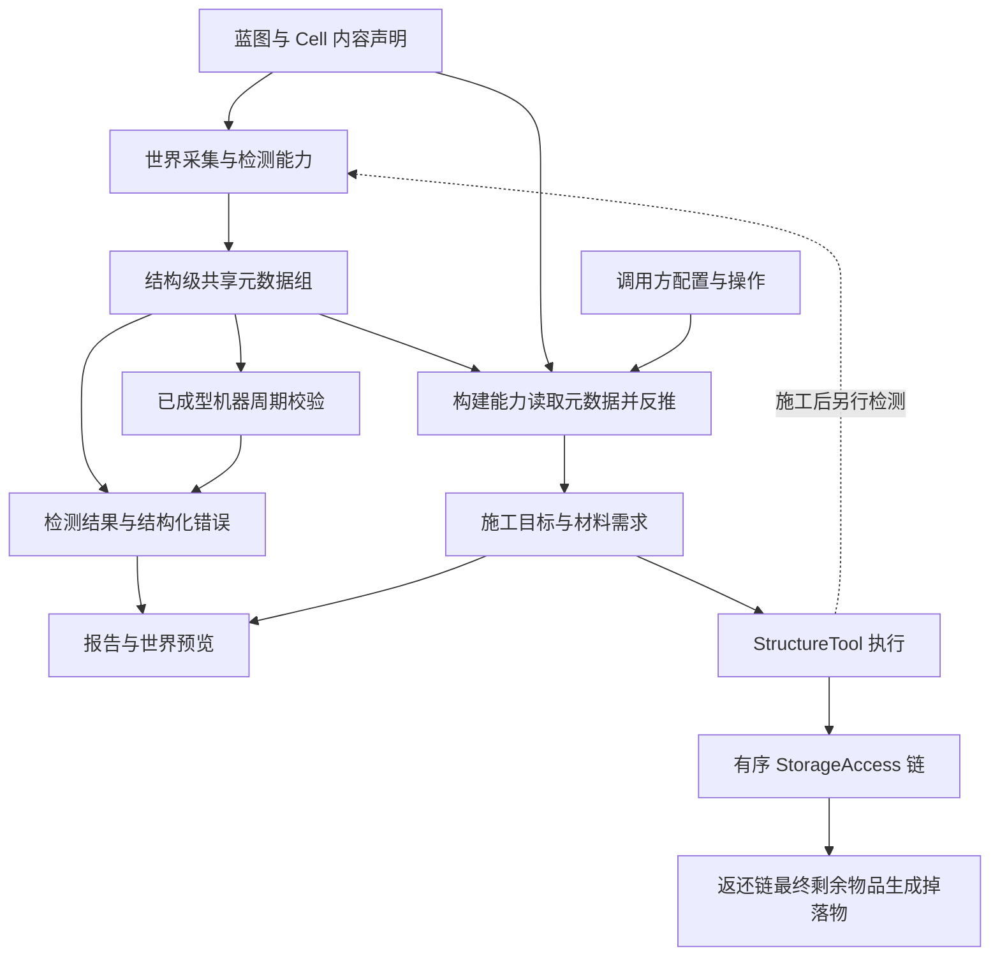

# 职责划分

面向框架开发者。此文保留原设计中的已确认约束和待落实方案；实现状态以相关章节及源码为准。

| 对象 | 负责 | 不应承担 |
|---|---|---|
| 蓝图与 Cell 定义 | 布局、具体检测条件、检测器绑定、展示和建造所需的内容声明 | 检测器实例中的内容存储、实际世界修改 |
| 机器与通用数据系统 | 提供现有 `MachineDataScope`、有类型字段、持久化和同步设施 | 定义多方块专属字段、检测或放置业务规则 |
| 多方块控制器组件 | 组合蓝图与元数据，在自身数据域声明结构元数据分组，协调能力与生命周期 | 要求扩展方继承控制器或新增机器子类 |
| `CellPredicate` | 根据本次输入与共享元数据检测，按能力契约探测／校验数据，输出标准结果 | 在检测器实例中绑定具体 Cell、方块、角色、材料候选、图标、文案或放置行为 |
| 流程元数据组 | 统一承载框架与外部检测能力提供的结构信息，支撑后续校验和构建反推 | 保存检测算法或替代具体阶段的结果、权限与资源核算 |
| 检测引擎 | 朝向、镜像、重复段解析、数据采集、维护周期元数据、调用检测器、聚合结果 | 玩家交互、背包读取、聊天输出 |
| 展示层 | 将检测结果转换为本地化报告、图标和虚影 | 再次推断检测失败原因 |
| 外部放置判断与选择实现 | 根据已有元数据、内容声明和配置反推具体目标，补充必要选择 | 取代结构检测、直接扣料或修改世界 |
| `StructureTool` | 检测、施工规划、分批放置、拆除、返还与执行结果 | 固定要求玩家或手持 Item、硬编码某个仓储 mod |
| `StorageAccess`（通用仓储层） | 封装具体仓储访问，批量取出与接收，返回实际满足和剩余需求 | 依赖结构元数据、决定结构布局、修改世界、要求框架枚举库存 |
| 调用方 | 交互、配置来源、提供器顺序、执行权限与反馈方式 | 另写一套 Cell 匹配和错误判断逻辑 |

框架提供能力，Demo 提供 Item 调用示例；与框架不直接提供管道探测器 Item 的边界保持一致。

